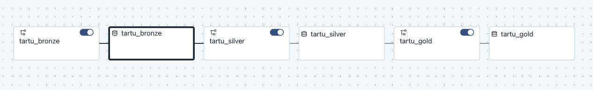
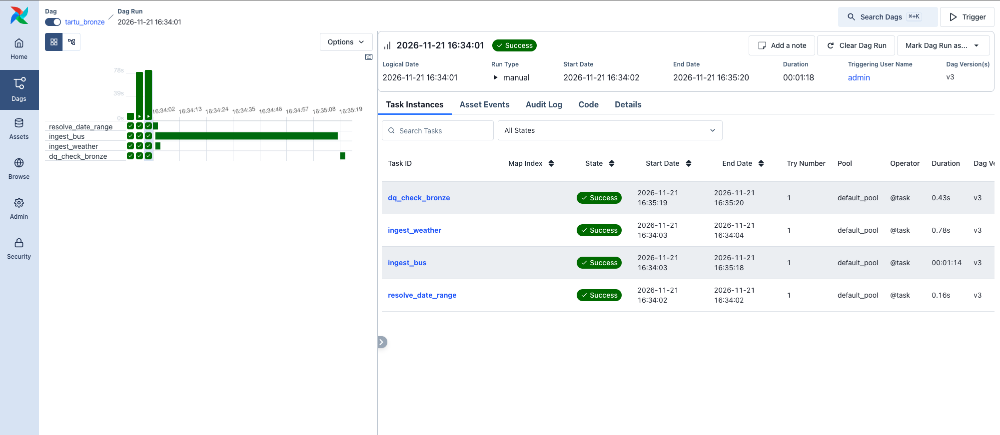
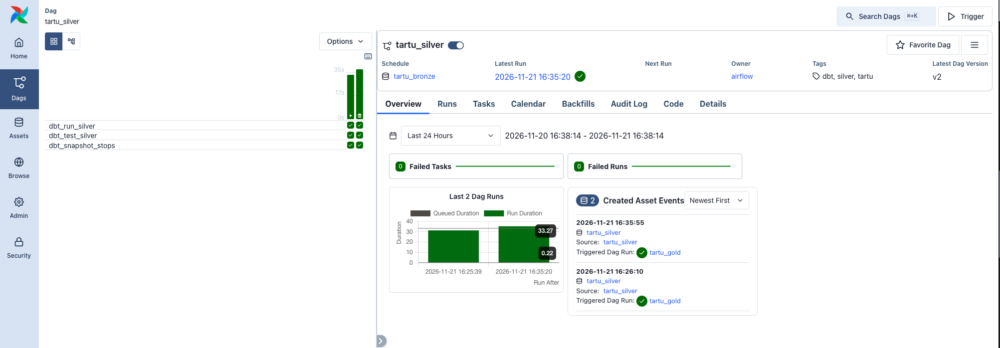
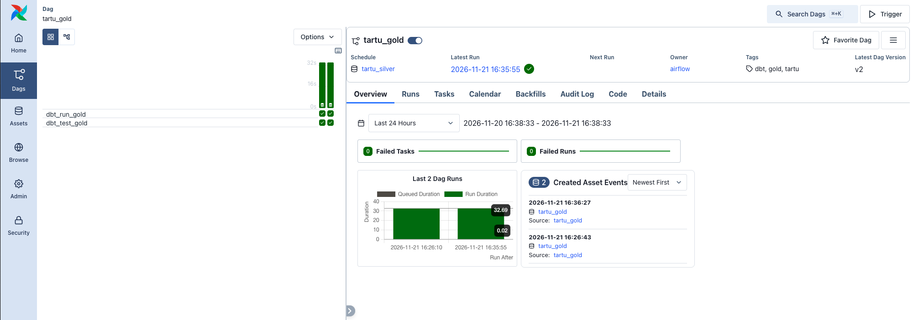
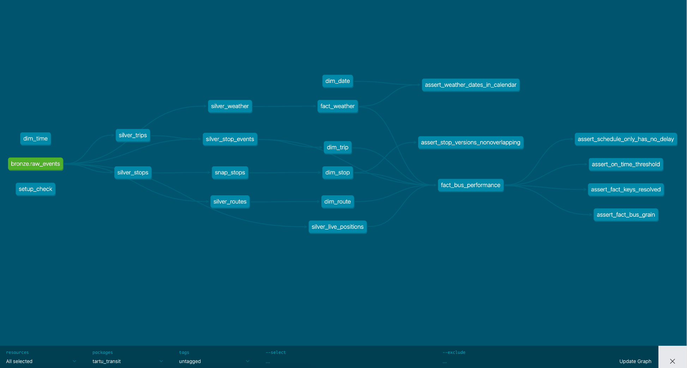

# Airflow data warehouse

The pipeline is split into one DAG per layer, chained with Airflow Assets (each DAG starts when the previous one succeeds):

| DAG | Trigger | What it does |
|---|---|---|
| [`tartu_bronze`](dags/tartu_bronze.py) | daily | Loads collector datasets from the public Azure Blob manifest into `bronze` |
| [`tartu_silver`](dags/tartu_silver.py) | after `tartu_bronze` | Bronze → silver: `dbt seed`, `dbt run` + `dbt test` silver models, `dbt snapshot` stops |
| [`tartu_gold`](dags/tartu_gold.py) | after `tartu_silver` | Silver → gold: `dbt run` + `dbt test` the star schema |

**To run:** unpause `tartu_bronze` in the Airflow UI and trigger it. Silver and gold run automatically afterwards.
`tartu_silver` and `tartu_gold` are created unpaused. If they show as paused (for example on an older Airflow
database), unpause them first, otherwise bronze finishes and nothing runs after it.

### DAG chain (Airflow Assets)

Each layer DAG updates its Asset when it succeeds, which triggers the next layer:



### Airflow DAG runs

**`tartu_bronze`**: resolve the date range, ingest weather and bus files, run the data-quality check.



**`tartu_silver`**: load the seeds (Tartu district centres), build the silver models, test them, then snapshot stops (`snap_stops`) for `dim_stop`.



**`tartu_gold`**: build the gold star schema, then run the gold schema tests and singular tests.



### dbt model dependencies

Lineage from `dbt docs generate`: `bronze.raw_events` → silver models → `snap_stops` → gold dimensions and facts → singular tests.



### Ingestion code description:

- [`pipeline.py`](ingestion/pipeline.py) runs ingestion workflow and  loading.
- [`storage.py`](ingestion/storage.py) downloads the public manifest and raw data files.
- [`readers.py`](ingestion/readers.py) unzips/reads JSON and JSONL snapshots.
- [`validation.py`](ingestion/validation.py) verifies file size/checksum and performs data-quality checks.
- [`loader.py`](ingestion/loader.py) creates and loads the Bronze tables. (into `bronze.raw_events`)


By default, the dag loads files from today and yesterday.
You can optionally set a DAG-run `start_date`, like `2026-10-21`, to load onwards.


## Setup

Run to create a local `.env` file. (Chose this over .env.example as we can generate secrets).

### Bash (Mac/Linux)

```bash
cd data_warehouse

umask 077

cat > .env <<EOF
POSTGRES_PASSWORD=$(openssl rand -hex 24)
AIRFLOW_FERNET_KEY=$(python3 -c 'import base64, os; print(base64.urlsafe_b64encode(os.urandom(32)).decode())')
AIRFLOW_JWT_SECRET=$(openssl rand -hex 64)
AIRFLOW_API_SECRET_KEY=$(openssl rand -hex 32)
AIRFLOW_ADMIN_USERNAME=admin
AIRFLOW_ADMIN_PASSWORD=$(openssl rand -hex 16)
AIRFLOW_ADMIN_EMAIL=admin@example.com
PGADMIN_DEFAULT_EMAIL=admin@example.com
PGADMIN_DEFAULT_PASSWORD=$(openssl rand -hex 16)
EOF

chmod 600 .env

```

### PowerShell (Windows)

```powershell
cd data_warehouse

$rand = [Security.Cryptography.RandomNumberGenerator]::Create()

function Secret($n) {
    $b = New-Object byte[] $n
    $rand.GetBytes($b)
    ([BitConverter]::ToString($b) -replace '-', '').ToLower()
}

$b = New-Object byte[] 32
$rand.GetBytes($b)
$fernet = [Convert]::ToBase64String($b).Replace('+','-').Replace('/','_')

@"
POSTGRES_PASSWORD=$(Secret 24)
AIRFLOW_FERNET_KEY=$fernet
AIRFLOW_JWT_SECRET=$(Secret 64)
AIRFLOW_API_SECRET_KEY=$(Secret 32)
AIRFLOW_ADMIN_USERNAME=admin
AIRFLOW_ADMIN_PASSWORD=$(Secret 16)
AIRFLOW_ADMIN_EMAIL=admin@example.com
PGADMIN_DEFAULT_EMAIL=admin@example.com
PGADMIN_DEFAULT_PASSWORD=$(Secret 16)
"@ | Set-Content .env -Encoding utf8

$rand.Dispose()

```


### Then run (your docker) and the Docker:
```
docker compose build
docker compose up -d
```

### UI links (Airflow and pgAdmin)

Airflow: http://localhost:8080

pgAdmin: http://localhost:5050

---

To Connect the PostGRE server to pgadmin use

|Var|Value|
|---|---|
|Name|`data_warehouse`|
|Host|`postgres`|
|Port|`5432`|
|Maintenance db|`warehouse`|
|Username|`warehouse_admin`|
|Password|POSTGRES_PASSWORD (in .env)|

---

