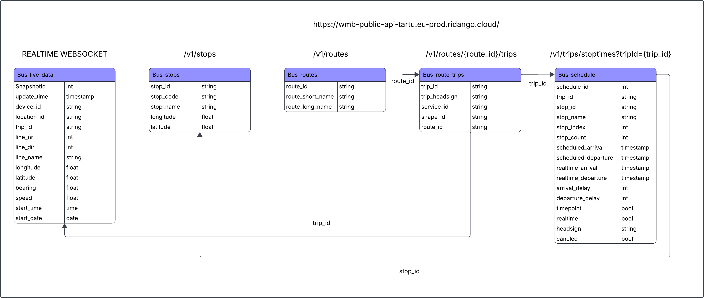

# Initial data architecture & modeling 

In the folder, there are following files:
* Python-scripts for accessing [live bus data](data_discovery/bus_live_data.py) and [live weather data](data_discovery/weather_data.py).
* [Description of the both datasets: live bus data and live weather data](docs/Datasets.md).
* Sample data snapshots of [raw live bus data](data_discovery/sample_bus_data_snapshot.json) and [raw live weather data](data_discovery/sample_weather_data_snapshot.json).
* [Star_Schema](modeling/star_schema.png) and [SQL Demo for Star Schema](modeling/star_schema.sql).
* [Data Dictionary](docs/Data_dictionary.md) of the star schema.
* [SQL Demo Queries](modeling/Demo_queries.sql) based on the project's Business Questions.

## Data Sources
The full descriptions of the datasets can be found [here](docs/Datasets.md).

### How the live bus data is structured in the model?
Bus movement and schedule data is queried from [tartu.pilet.ee](https://tartu.pilet.ee/et/explore?selectedTab=routes) and is used to describe:

* Bus locations and movements (`Bus-live-data`, 14 columns)
* Bus stops (`Bus-stops`, 5 columns)
* Routes (`Bus-routes`, 3 columns)
* Scheduled trips (`Bus-route-trips`, 5 columns)
* Scheduled times (`Bus-schedule`, 16 columns)

## Data Dictionary
The project's Data Dictionary for star schema can be found [here](docs/Data_dictionary.md).

### [Project 1 Report](docs/Project_1_report_team13.md)